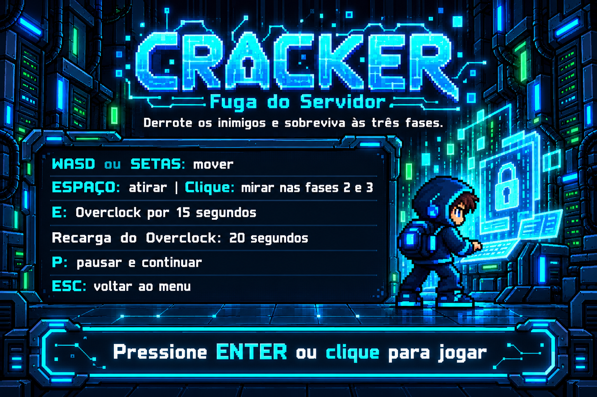

# Cracker — Fuga do Servidor

Jogo feito em Java com Greenfoot. Você controla Byte, enfrenta inimigos e tenta escapar de um servidor em três fases.

## Como abrir

1. Instale o Greenfoot no computador.
2. Baixe este repositório pelo botão **Code > Download ZIP** e extraia a pasta.
3. Abra o arquivo `project.greenfoot` no Greenfoot.
4. Compile o projeto e clique em **Run** ou **Executar**.
5. Pressione **Enter** ou clique no menu para começar.

Se o menu não aparecer, clique com o botão direito na classe `Menu` e escolha `new Menu()`.

## Controles

| Tecla | Ação |
| --- | --- |
| WASD ou setas | Mover Byte |
| Espaço | Atirar na última direção de movimento |
| Clique na arena | Mirar e atirar nas fases 2 e 3 |
| E | Ativar o Overclock |
| P | Pausar ou continuar |
| Esc | Voltar ao menu |
| Enter ou clique | Avançar nas telas de menu e resultado |

## Fases

- **Fase 1:** derrotar um Bug.
- **Fase 2:** derrotar 12 inimigos, desviando dos tiros e das paredes de código.
- **Fase 3:** derrotar o chefe Trojan.

Byte começa com três vidas. Os fragmentos de dados dão pontos. O Overclock aumenta a velocidade e a pontuação por 15 segundos, com 20 segundos de recarga após o efeito.

## Tecnologias

- **Java:** regras e funcionamento do jogo.
- **Greenfoot:** cenários, personagens, imagens, teclado, mouse e colisões.
- **PNG:** imagens dos personagens e das telas. Parte das artes foi gerada com ajuda de inteligência artificial.

## Arquivos principais

- `project.greenfoot`: abre o projeto no Greenfoot.
- `FaseBase.java`: reúne as regras usadas nas fases.
- `Fase1.java`, `Fase2.java` e `Fase3.java`: organizam cada fase.
- `Byte.java`: controla o jogador.
- As outras classes cuidam dos inimigos, tiros, itens, paredes e telas.
- `images/`: guarda as imagens do jogo.
- [README.TXT](README.TXT): explica as regras com mais detalhes.

O jogo funciona localmente, sem precisar de conexão com a internet durante a partida.
